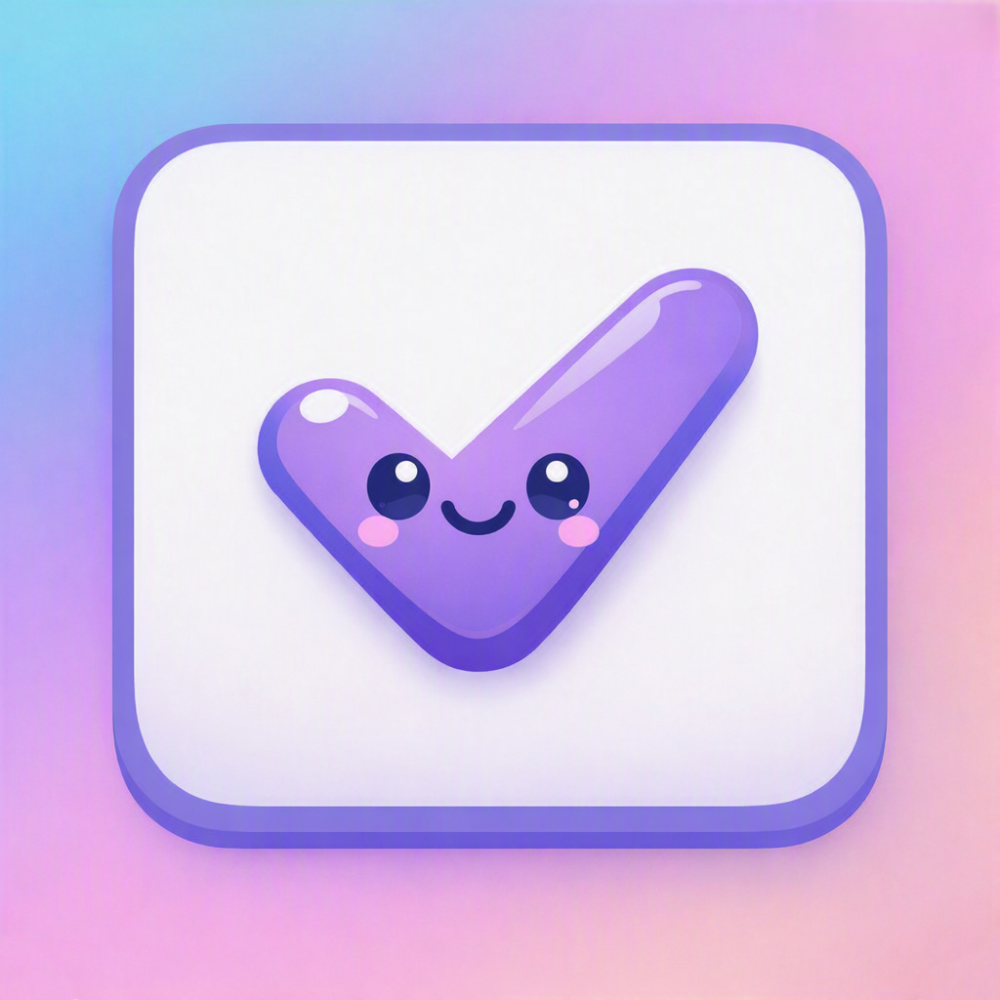
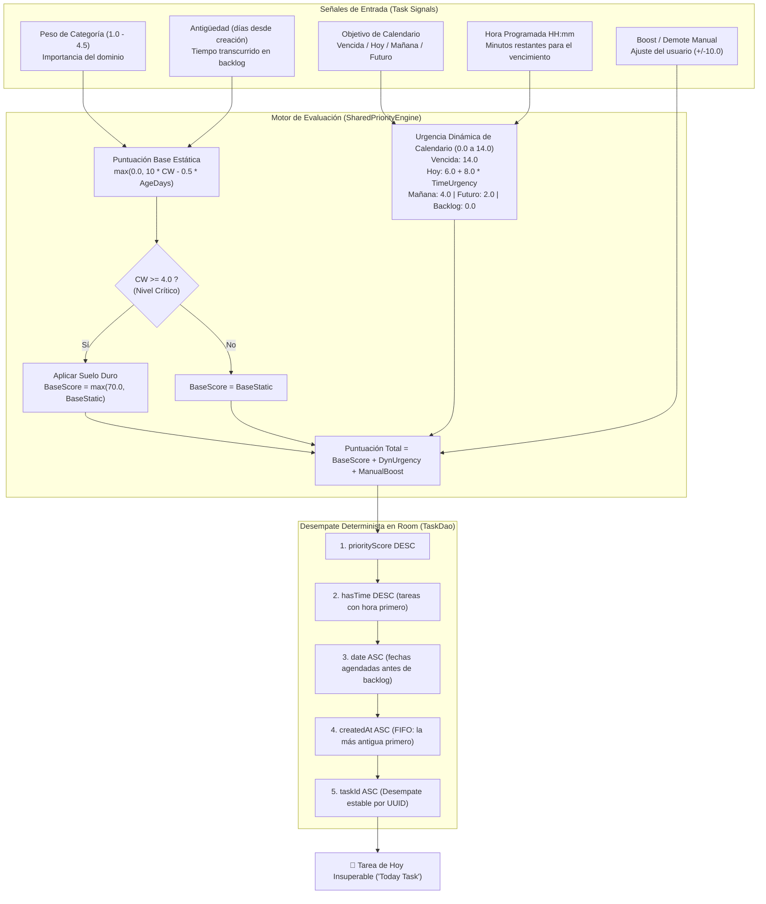
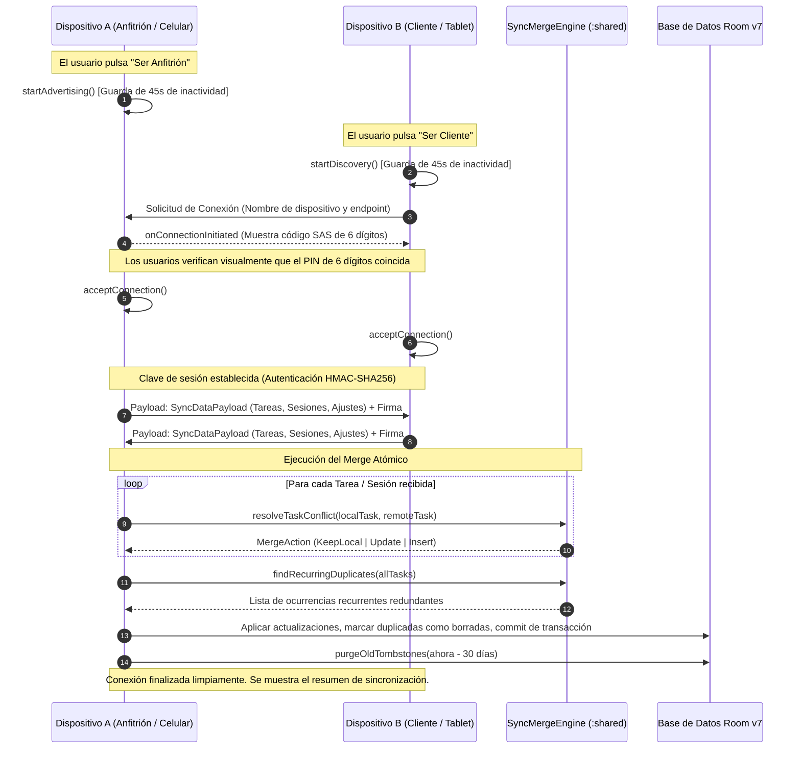

<p align="center">
  
</p>

# Prima Focus

> **Gestor de tareas y sesiones de enfoque Pomodoro nativo para Android, con arquitectura local-first, priorización predictiva determinista y sincronización de estado distribuido peer-to-peer sin conexión a la nube.**

[English](README.md) | [Español](README.es.md)


-blue?style=flat)
-4285F4?style=flat&logo=sqlite&logoColor=white)


---

## Descripción del Proyecto

**Prima Focus** es una aplicación de productividad nativa para Android construida con una capa de dominio modular en **Kotlin Multiplatform (KMP)**. Diseñada bajo principios de ingeniería *local-first*, almacena todos los registros persistentes estrictamente en el dispositivo, garantizando cero dependencia de servidores en la nube, privacidad absoluta y respuesta inmediata en submilisegundos.

En lugar de recurrir a modelos opacos de machine learning o listas manuales desordenadas, Prima Focus utiliza un **Motor Predictivo de Puntuación de Prioridad** transparente y matemáticamente formulado para evaluar señales de cada tarea (importancia, decaimiento por antigüedad, plazos de calendario y proximidad horaria) para elegir dinámicamente una única e inequívoca **"Tarea de Hoy"** (*Today Task*). Para flujos de trabajo multidispositivo, ofrece sincronización reforzada peer-to-peer (P2P) mediante Wi-Fi Direct y Bluetooth Low Energy a través de Google Nearby Connections, gobernada por un algoritmo de resolución de conflictos *Last-Write-Wins* (LWW) inmune a desvíos de reloj (*clock drift*) y consciente de versiones lógicas.

---

## Motor Predictivo de Puntuación de Prioridad

El motor central calcula una puntuación numérica determinista para cada tarea activa, desacoplando los cálculos de negocio de la interfaz gráfica a través del módulo puro en Kotlin `:shared`.



### Formulación Matemática Central
$$\text{PriorityScore} = \text{BaseScore} + \text{DynamicUrgency} + \text{ManualBoost}$$

1. **Base Estática y Decaimiento por Antigüedad**:
   $$\text{BaseScoreStatic} = \max\left(0.0,\; 10 \cdot \text{categoryWeight} - 0.5 \cdot \text{ageDays}\right)$$
   Por cada día que una tarea no crítica permanece en el backlog, su puntuación decae en $0.5$ puntos para evitar que tareas obsoletas saturen la cola, con un tope inferior de $0.0$.
2. **Restricción Dura: Suelo Crítico ($\ge 70.0$)**:
   Si $\text{categoryWeight} \ge 4.0$ (ej. recetas médicas o entregas críticas de trabajo), $\text{BaseScore} = \max(70.0, \text{BaseScoreStatic})$. Las obligaciones vitales están matemáticamente blindadas contra cualquier decaimiento por debajo de tareas rutinarias.
3. **Urgencia Dinámica de Calendario**:
   - **Vencida (*Overdue*)**: $+14.0$ puntos.
   - **Hoy**: $+6.0 \cdot \text{hasDate} + 8.0 \cdot \text{timeUrgency}$ (escala hasta $+14.0$ si faltan $\le 2$ horas para la hora programada o ya pasó la hora hoy).
   - **Mañana**: $+4.0$ puntos.
   - **Fecha Futura**: $+2.0$ puntos.
   - **Backlog**: $+0.0$ puntos.
4. **Desempate Determinista en Room (`TaskDao`)**:
   `priorityScore DESC` $\to$ `hasTime DESC` $\to$ `date ASC` $\to$ `createdAt ASC` $\to$ `taskId ASC`.

*Para la demostración matemática completa y casos de estudio comparativos paso a paso, consulta la [Documentación de Lógica de Prioridades](docs/priority-logic.md).*

---

## Sincronización Peer-to-Peer y Resolución Distribuida de Conflictos

Prima Focus coordina el estado entre dispositivos mediante redes locales directas P2P utilizando Google Nearby Connections (topología `P2P_STAR`). No requiere intermediarios en la nube, creación de cuentas ni servidores de retransmisión.



### Las 8 Invariantes de Estado Distribuido

Todas las rutinas de resolución de conflictos en `SyncMergeEngine` son deterministas y están verificadas mediante pruebas unitarias automatizadas:

| Invariante | Problema Resuelto | Mecanismo y Garantía |
| :--- | :--- | :--- |
| **1. Propagación de Lápidas (*Tombstones*)** | Eliminaciones físicas en Dispositivo A que resucitan en Dispositivo B tras sincronizar. | Los borrados se convierten en lápidas lógicas (`isDeleted = true`, `deletedAt`). Una `syncVersion` superior asegura que la lápida sobrescriba instancias activas antiguas en todos los nodos. |
| **2. Rechazo de Ediciones Obsoletas (*Stale Edits*)** | Ediciones hechas en un dispositivo desconectado desactualizado sobrescribiendo cambios nuevos. | La verificación de versión monótona (`syncVersion`) rechaza estrictamente cualquier carga entrante con número de versión inferior (`MergeAction.KeepLocal`). |
| **3. Inmunidad a Desfase de Reloj (*Clock Drift*)** | Dispositivos con relojes desincronizados o manipulados sobrescribiendo ediciones legítimas. | Se evalúa `syncVersion` antes que `updatedAt`. Un dispositivo con reloj atrasado horas pero con versión incrementada vencerá a un dispositivo con reloj adelantado. |
| **4. Desempate en Empates Totales (*Full-Tie*)** | Dos dispositivos editan la misma tarea en el mismo milisegundo con la misma versión. | El hash SHA-256 del contenido de los campos visibles desempata. Ambos dispositivos calculan el hash localmente y convergen al mismo ganador sin mensajes adicionales de red. |
| **5. No-Regresión de Tareas Completadas** | Tareas completadas que se reabren como "pendientes" porque otro dispositivo sincronizó un estado viejo. | Si el estado local es `completed` y el remoto es `pending`, el estado completado se preserva estrictamente y se incrementa `syncVersion = max(vL, vR) + 1` para sellar la divergencia. |
| **6. Deduplicación de Recurrencias Concurrentes** | Dos dispositivos desconectados generando concurrentemente la siguiente ocurrencia del mismo día. | IDs deterministas (`UUID.nameUUIDFromBytes("$groupId|$date")`) + `findRecurringDuplicates` identifica y manda a lápida las instancias redundantes, conservando la de mayor versión. |
| **7. Convergencia de Configuraciones** | Preferencias sincronizadas (emojis de categoría, política de recurrencias salteadas) divergentes. | Last-Write-Wins sobre `settingsUpdatedAt`, con desempate por ID de dispositivo estable (`remoteDeviceId > localDeviceId`) en caso de marcas de tiempo idénticas. |
| **8. Rechazo Criptográfico de Manipulaciones** | Ataques de intermediario (MITM) o transmisiones corruptas en la red Wi-Fi local. | Los paquetes se firman con HMAC-SHA256 usando la clave de sesión acordada en el emparejamiento numérico; paquetes alterados fallan la verificación y se descartan de inmediato. |

*Para diagramas de flujo arquitectónicos detallados y ciclo de vida de migraciones, consulta [Arquitectura del Sistema](docs/architecture.md).*

---

## Estructura Modular y Responsabilidades

```text
prima-focus/
├── app/
│   └── android/
│       ├── app/                   # Módulo cliente nativo Android (:app)
│       │   ├── src/main/          # UI Compose, ViewModels, Room v7, Widgets, P2P Nearby
│       │   └── src/test/          # Pruebas unitarias de DAOs, migraciones, widgets y casos de uso
│       ├── shared/                # Módulo de dominio puro Kotlin Multiplatform (:shared)
│       │   ├── src/main/          # SharedPriorityEngine, SyncMergeEngine, LANAuthSecurity, modelos
│       │   └── src/test/          # Matriz de conflictos distribuidos y pruebas de dominio KMP
│       └── gradle/                # Catálogo de versiones (libs.versions.toml) y scripts de build
├── docs/                          # Especificaciones técnicas de arquitectura y guías de pruebas
└── README.es.md                   # Documentación canónica en Español
```

### Matriz de Responsabilidad por Componente

| Módulo | Capa Arquitectónica | Responsabilidades Primarias |
| :--- | :--- | :--- |
| **`:shared`** | Dominio Puro (KMP) | Heurística de priorización (`SharedPriorityEngine`), resolución LWW (`SyncMergeEngine`), proyección de recurrencias (`SharedRecurrenceCalculator`), firmas HMAC (`LANAuthSecurity`). Totalmente agnóstico a Android. |
| **`:app`** | Persistencia Nativa | Base de datos Room v7 con scripts de migración (`MIGRATION_4_5`, `MIGRATION_5_6`, `MIGRATION_6_7`), lápidas lógicas y recolección de basura SQLite a 30 días. |
| **`:app`** | Presentación e Interfaz | Pantallas en Jetpack Compose Material 3, vistas divididas adaptativas para tabletas, `NavigationRail`, motor de partículas de confeti en Canvas y temas Material You. |
| **`:app`** | Servicios en Segundo Plano | Tareas en `WorkManager` para reconciliación de recurrencias y purga de lápidas; Foreground Services para temporizadores de enfoque de alta precisión. |
| **`:app`** | Widgets de Pantalla de Inicio | Widgets en Jetpack Glance (Tarea de Hoy y lista de 3 tareas) con feedback optimista instantáneo y notificación de deshacer. |

---

## Verificación Automatizada y Cobertura de Pruebas

El código está respaldado por suites de pruebas unitarias automatizadas que cubren la máquina de estados distribuidos, migraciones de base de datos, heurística de prioridades y lógica de widgets en ambos módulos.

### Matriz de Cobertura de Pruebas

| Suite de Pruebas | Módulo | Escenarios e Invariantes Verificados |
| :--- | :--- | :--- |
| **`SyncConflictMatrixTest`** | `:shared` | Matriz distribuida insignia: propagación de lápidas, rechazo de ediciones viejas, tolerancia a reloj desfasado, desempate por SHA-256, no-regresión de tareas completadas, dedup de recurrencias, LWW de ajustes y detección de alteraciones con HMAC-SHA256. |
| **`SharedCoreEngineTest`** | `:shared` | Ajustes simétricos de boost/demote, proyecciones diarias/semanales, salto de recurrencias vencidas (*skip-missed*), y estabilidad determinista de IDs de recurrencia. |
| **`PriorityBandTest`** | `:shared` | Mapeo dinámico de puntuaciones continuas a rangos semánticos (`CRITICAL`, `HIGH`, `MEDIUM`, `LOW`) alineados con el sistema de diseño. |
| **`LongPendingCelebrationTest`** | `:shared` | Cálculo seguro de diferencia en días, protección ante desbordamiento aritmético, formateo de duraciones y umbrales de celebración (14, 30, 60, 90 días). |
| **`PriorityEngineTest`** | `:app` | Delegación del dominio Android, dominancia de tareas de hoy sobre mañana, piso cero en decaimiento por edad y persistencia de metadatos tras recálculo. |
| **`DatabaseMigrationTest`** | `:app` | Verificación de sentencias DDL en migraciones de Room: eliminación de tablas huérfanas (`MIGRATION_5_6`), agregado de `missedPolicy` (`MIGRATION_6_7`), e inyección de lápidas y `syncVersion` (`MIGRATION_4_5`). |
| **`TaskCompletionUseCaseTest`** | `:app` | Finalización idempotente, registro de sesiones, generación de siguientes ocurrencias, resolución de políticas de recurrencias salteadas e incrementos de `syncVersion`. |
| **`WidgetLogicTest`** | `:app` | Filtrado de widgets Jetpack Glance (todas, no recurrentes, recurrentes) y algoritmos de selección de backlog atrasado o postergado. |
| **`P2PSyncTest`** | `:app` | Serialización/deserialización de payloads con lápidas, compatibilidad hacia atrás con formato array v1 y viaje de ida y vuelta de ID de dispositivo. |

### Ejecución de las Suites de Pruebas

Para ejecutar la totalidad de pruebas unitarias automatizadas, utiliza los siguientes comandos desde la terminal:

```powershell
# Navegar a la raíz del proyecto Android
cd app/android

# Ejecutar pruebas del cliente Android y migraciones de Room
./gradlew testDebugUnitTest

# Ejecutar pruebas del dominio KMP compartido, prioridades y conflictos P2P
./gradlew :shared:test

# Ejecutar ambas suites en una sola pasada unificada
./gradlew testDebugUnitTest :shared:test
```

> **Estado de Verificación**: Todas las suites de pruebas unitarias automatizadas se ejecutan con 100% de éxito y cero regresiones.

---

## Arquitectura de Producto y Experiencia de Usuario

Prima Focus conecta la complejidad técnica distribuida con una experiencia de usuario cuidada e intuitiva:

- **Tarjeta Insignia "Tarea de Hoy"**: Destaca con claridad la tarea ganadora con tarjetas en estilo Glassmorphism (encadenamiento canónico de modificadores `background` $\to$ `border` $\to$ `clip`) y acceso directo al temporizador Pomodoro.
- **Widgets Interactivos con Jetpack Glance**: Widgets para la Tarea de Hoy y la Lista Rápida de 3 Tareas con **feedback optimista inmediato**: al completar una tarea se muestra al instante un check visual y se emite una notificación con acción "Deshacer", evitando la latencia de redibujado de Glance.
- **Diseño Adaptativo para Tabletas**: Interfaces responsivas en Material 3 que evolucionan fluidamente de una barra de navegación inferior en móviles a un `NavigationRail` permanente y vista dividida con calendario en tabletas.
- **Motor de Confeti en Canvas**: Reconocimiento al completar tareas añejadas postergadas por mucho tiempo (más de 14, 30, 60 o 90 días) mediante un motor físico de partículas acelerado por hardware con Compose `Canvas` y `withFrameNanos`.
- **Pantalla de Sincronización P2P Clara**: Panel dedicado donde el usuario elige su rol ("Ser Anfitrión" o "Ser Cliente") con indicadores de estado en vivo, comparación mutua de código SAS numérico de 6 dígitos y temporizador de desconexión automática a los 45 segundos para ahorro de batería.

---

## Stack Tecnológico y Herramientas

- **Lenguaje**: Kotlin 2.2.10 (Kotlin Multiplatform)
- **Toolchain de Java**: OpenJDK 17
- **Librería de UI**: Jetpack Compose (Material 3 con Adaptive Window Size Class)
- **Persistencia**: Room Database v7 (SQLite) con compilador KSP
- **Widgets de Escritorio**: Jetpack Glance 1.1.1 (integración con Material 3)
- **Comunicaciones de Red**: Google Nearby Connections API 19.3.0
- **Asincronía y Concurrencia**: Kotlinx Coroutines 1.8.0 y StateFlow
- **Procesamiento en Segundo Plano**: Android WorkManager 2.9.0
- **Serialización y Criptografía**: Gson 2.10.1, Java Cryptography Extension (HMAC-SHA256, SHA-256)
- **Sistema de Compilación**: Gradle 9.4.1 con Catálogos de Versiones (`libs.versions.toml`)

---

## Compilación y Ejecución Local

### Prerrequisitos
- Android Studio Ladybug (2024.2.1+) o superior
- JDK 17 (configurado mediante `JAVA_HOME`)
- Android SDK 34+ con Build Tools instalados

### Comandos de Compilación

```powershell
# Clonar el repositorio
git clone https://github.com/AnaCataVC/prima-focus.git
cd prima-focus/app/android

# Compilar APK de depuración
./gradlew assembleDebug

# Compilar APK de producción
./gradlew assembleRelease
```
*Los binarios compilados se ubican en `app/android/app/build/outputs/apk/`.*

---

## Decisiones de Arquitectura y Aprendizajes Clave

1. **Desacoplamiento Modular con KMP**: Extraer la heurística de prioridades y el resolvedor de conflictos a un módulo independiente en Kotlin Multiplatform (`:shared`) permitió diseñar pruebas unitarias completas en la JVM que se ejecutan en segundos sin emulador, marcando una separación nítida entre lógica de negocio y UI de Android.
2. **Inmunidad a Clock Drift mediante LWW en Dos Niveles**: La sincronización peer-to-peer móvil en el mundo real no puede fiarse del reloj del sistema debido a cambios de zona horaria o desvíos del reloj. Establecer `syncVersion` como primer filtro de precedencia eliminó por completo los bugs de sobrescritura de datos nuevos.
3. **Convergencia Determinista de Empates Totales con SHA-256**: En sistemas distribuidos sin nodo coordinador central, ediciones simultáneas idénticas en versión y milisegundo representan un problema clásico de consenso. El hash SHA-256 de los campos de contenido ofrece una solución simétrica, determinista y de cero latencia de red.
4. **No-Regresión del Estado Completado**: Las pruebas revelaron que al completar una tarea en el Celular A, una Tablet B sin conexión que sincronizara más tarde podía reabrir la tarea si su reloj estaba ligeramente adelantado. Implementar una guarda de no-regresión directamente en `SyncMergeEngine` cerró este caso de borde permanentemente.
5. **Ciclo de Vida de Lápidas con Recolección de Basura a 30 Días**: En bases de datos *local-first*, las eliminaciones físicas provocan la reaparición de tareas al sincronizar con dispositivos que no habían recibido la noticia. El uso de lápidas lógicas junto con una rutina automática de recolección de basura SQLite al iniciar la app mantiene la base de datos optimizada sin revivir registros zombi.

---

## Índice de Documentación Técnica

Explora la documentación técnica completa para profundizar en cada subsistema:
- [Especificación de Lógica y Prioridades](docs/priority-logic.md)
- [Arquitectura del Sistema y Flujo de Red](docs/architecture.md)
- [Esquema de Base de Datos v7 y Migraciones](docs/database_schema.sql)
- [Flujo de Notificaciones y Ciclo de Vida](docs/notification_flow.md)
- [Especificaciones de UI y Tokens](docs/ui_spec.md)
- [Aprendizaje: Confeti en Canvas y Bordes en Tarjetas](docs/learning/compose-card-borders-and-confetti.md)
- [Aprendizaje: Sincronización P2P, Lápidas y Clock Drift](docs/learning/p2p-sync-tombstones-clockdrift-gc.md)
- [Todos los Aprendizajes de Arquitectura](docs/learning/)

---

## Licencia

Este proyecto está bajo la Licencia MIT. Consulta el archivo [LICENSE](LICENSE) para más detalles.
