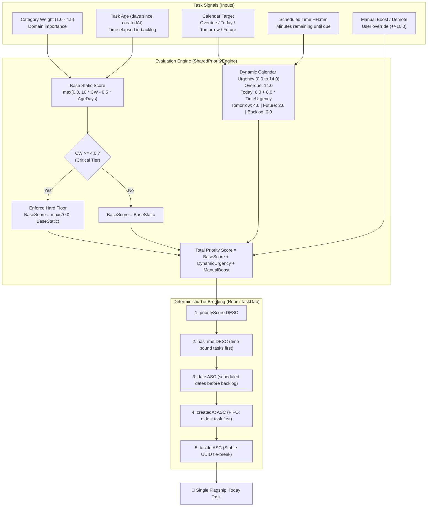
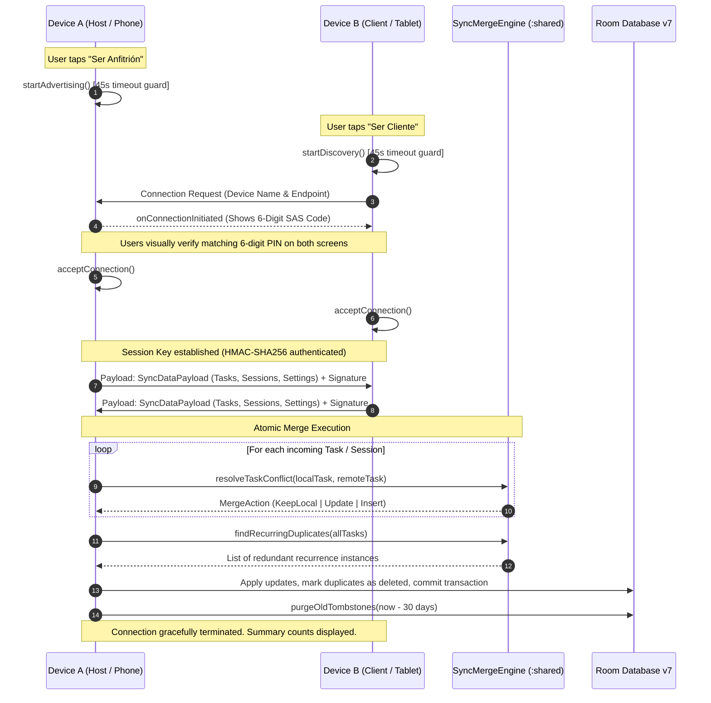

<p align="center">
  
</p>

# Prima Focus

> **A native, local-first Android task manager and Pomodoro focus system powered by deterministic predictive prioritization and offline peer-to-peer distributed state synchronization.**

[English](README.md) | [Español](README.es.md)


-blue?style=flat)
-4285F4?style=flat&logo=sqlite&logoColor=white)


---

## Project Description

**Prima Focus** is a native Android productivity application built with a **modular Kotlin Multiplatform (KMP)** domain layer. Designed under local-first engineering principles, it stores all persistent records strictly on-device, guaranteeing zero cloud dependencies, complete user privacy, and instant sub-millisecond responsiveness.

Instead of relying on opaque machine-learning models, Prima Focus uses a transparent, mathematically proven **Predictive Priority Scoring Engine** to evaluate task signals (importance, age decay, calendar deadlines, and approaching times) to dynamically elect a single, unequivocal **"Today Task"**. For multi-device workflows, it provides hardened peer-to-peer (P2P) synchronization over Wi-Fi Direct and Bluetooth Low Energy via Google Nearby Connections, governed by a clock-drift resilient, version-aware Last-Write-Wins (LWW) conflict resolution algorithm.

---

## Predictive Priority Scoring Engine

The central engine computes a deterministic numeric score for every active task, decoupling business calculations from UI rendering via the pure Kotlin `:shared` module.



### Core Formulation
$$\text{PriorityScore} = \text{BaseScore} + \text{DynamicUrgency} + \text{ManualBoost}$$

1. **Static Base & Aging Decay**:
   $$\text{BaseScoreStatic} = \max\left(0.0,\; 10 \cdot \text{categoryWeight} - 0.5 \cdot \text{ageDays}\right)$$
   Every day a non-critical task remains in the backlog, it decays by $0.5$ points to prevent stale tasks from cluttering the queue, clamped to a floor of $0.0$.
2. **Hard Constraint: Critical Floor ($\ge 70.0$)**:
   If $\text{categoryWeight} \ge 4.0$ (e.g., medical prescriptions or urgent client deliverables), $\text{BaseScore} = \max(70.0, \text{BaseScoreStatic})$. Vital obligations are mathematically protected from ever decaying beneath routine items.
3. **Dynamic Calendar Urgency**:
   - **Overdue**: $+14.0$ points.
   - **Today**: $+6.0 \cdot \text{hasDate} + 8.0 \cdot \text{timeUrgency}$ (scales to $+14.0$ if within 2 hours of deadline or past due today).
   - **Tomorrow**: $+4.0$ points.
   - **Future Date**: $+2.0$ points.
   - **Backlog**: $+0.0$ points.
4. **Deterministic Tie-Breaking in Room (`TaskDao`)**:
   `priorityScore DESC` $\to$ `hasTime DESC` $\to$ `date ASC` $\to$ `createdAt ASC` $\to$ `taskId ASC`.

*For the complete mathematical proof and comparative step-by-step case studies, refer to [Priority Logic & Scoring Documentation](docs/priority-logic.md).*

---

## Peer-to-Peer Synchronization & Distributed Conflict Resolution

Prima Focus coordinates state across devices through direct local P2P networking via the Google Nearby Connections API (`P2P_STAR` topology). No cloud intermediary, account registration, or third-party relay is required.



### The 8 Distributed State Invariants

All conflict resolution routines in `SyncMergeEngine` are mathematically deterministic and verified by unit tests:

| Invariant | Problem Solved | Mechanism & Guarantee |
| :--- | :--- | :--- |
| **1. Tombstone Propagation** | Hard deletes on Device A resurrecting on Device B after sync. | Hard deletes are converted to soft-delete tombstones (`isDeleted = true`, `deletedAt`). Higher `syncVersion` ensures the tombstone overwrites older active instances on all peers. |
| **2. Stale Edit Rejection** | Edits made on an out-of-date offline device overwriting newer edits. | Monotonic version checking (`syncVersion`) strictly rejects any incoming payload with an inferior version number (`MergeAction.KeepLocal`). |
| **3. Clock-Drift Immunity** | Devices with un-synchronized or manipulated system clocks overwriting valid edits. | `syncVersion` is strictly checked before `updatedAt`. A device whose clock is hours in the past but has incremented its version will cleanly beat a device with a future-skewed clock. |
| **4. Full-Tie Convergence** | Two devices edit the same task during the exact same millisecond at the same version. | The SHA-256 content hash of all user-visible fields breaks the tie. Both devices compute the hash locally and deterministically converge to the exact same winner without additional network roundtrips. |
| **5. Non-Regressive Completion** | Completed tasks reopening as "pending" because another device synced an older state. | If local state is `completed` and remote is `pending`, the completed state is strictly preserved, and `syncVersion` is bumped to `max(vL, vR) + 1` to heal the divergence permanently. |
| **6. Concurrent Recurrence Dedup** | Two offline devices independently generating the next recurrence for the same day. | Deterministic instance IDs (`UUID.nameUUIDFromBytes("$groupId|$date")`) + `findRecurringDuplicates` identifies and tombstones redundant instances, keeping only the highest-version copy. |
| **7. Settings Convergence** | Synchronized preferences (category emojis, skip-missed policy) diverging across peers. | Last-Write-Wins on `settingsUpdatedAt`, with a stable per-device ID tie-breaker (`remoteDeviceId > localDeviceId`) in case of timestamp equality. |
| **8. Cryptographic Tamper Rejection** | MITM packet manipulation or corrupted transmissions on local Wi-Fi. | Payloads are signed with HMAC-SHA256 using the session secret key derived during the 6-digit SAS pairing handshake; tampered packets fail validation and are dropped immediately. |

*For in-depth architectural flowcharts and migration lifecycles, see [System Architecture](docs/architecture.md).*

---

## Architecture Overview & Module Structure

```text
prima-focus/
├── app/
│   └── android/
│       ├── app/                   # Android native client module (:app)
│       │   ├── src/main/          # Jetpack Compose UI, ViewModels, Room v7, Widgets, Nearby P2P
│       │   └── src/test/          # Unit tests for DAOs, migrations, widget logic & use cases
│       ├── shared/                # Pure Kotlin Multiplatform domain module (:shared)
│       │   ├── src/main/          # SharedPriorityEngine, SyncMergeEngine, LANAuthSecurity, models
│       │   └── src/test/          # Flagship distributed conflict matrix & domain unit tests
│       └── gradle/                # Version catalogs (libs.versions.toml) and build configuration
├── docs/                          # Comprehensive architectural specifications and test guides
└── README.md                      # Canonical English documentation
```

### Component Responsibility Matrix

| Module | Architectural Layer | Primary Responsibilities |
| :--- | :--- | :--- |
| **`:shared`** | Pure Domain (KMP) | Priority scoring heuristic (`SharedPriorityEngine`), LWW conflict resolution (`SyncMergeEngine`), recurrence projection (`SharedRecurrenceCalculator`), cryptographic HMAC signing (`LANAuthSecurity`). Completely platform-agnostic. |
| **`:app`** | Native Persistence | Room Database v7 with migration scripts (`MIGRATION_4_5`, `MIGRATION_5_6`, `MIGRATION_6_7`), soft-delete tombstones, and 30-day SQLite garbage collection routines. |
| **`:app`** | Presentation & UI | Jetpack Compose Material 3 screens, tablet adaptive split views, `NavigationRail`, custom Canvas particle physics confetti engine, and Material You theming. |
| **`:app`** | Background Services | `WorkManager` workers for recurrence reconciliation and automatic tombstone cleanup; Android Foreground Services for accurate focus timers. |
| **`:app`** | Home Screen Widgets | Jetpack Glance app widgets (single Today Task & 3-task list) with optimistic completion feedback and undo action notifications. |

---

## Automated Verification & Test Suites

The codebase is backed by automated unit test suites covering the distributed state machine, persistence migrations, priority heuristics, and presentation logic across both modules.

### Test Coverage Matrix

| Test Suite | Module | Verified Scenarios & Invariants |
| :--- | :--- | :--- |
| **`SyncConflictMatrixTest`** | `:shared` | Flagship distributed matrix: tombstone propagation, stale edit rejection, clock-drift immunity, SHA-256 tie-breaking, non-regressive completions, concurrent recurrence dedup, settings LWW, and HMAC-SHA256 tampering rejection. |
| **`SharedCoreEngineTest`** | `:shared` | Symmetrical boost/demote, daily/weekly recurrence projections, skip-missed overdue leaping, deterministic recurrence instance ID stability. |
| **`PriorityBandTest`** | `:shared` | Dynamic mapping from continuous priority scores to categorical bands (`CRITICAL`, `HIGH`, `MEDIUM`, `LOW`) matching the design system. |
| **`LongPendingCelebrationTest`** | `:shared` | Safe day delta calculations, arithmetic overflow prevention, localized duration formatting, and aged-task celebration trigger thresholds (14, 30, 60, 90 days). |
| **`PriorityEngineTest`** | `:app` | Android domain delegation, today-task domination over tomorrow tasks, age decay zero-floor clamping, and persistence of task metadata across recalculations. |
| **`DatabaseMigrationTest`** | `:app` | DDL verification of Room schema migrations: dropping dead legacy tables (`MIGRATION_5_6`), adding `missedPolicy` (`MIGRATION_6_7`), and injecting tombstones + `syncVersion` (`MIGRATION_4_5`). |
| **`TaskCompletionUseCaseTest`** | `:app` | Idempotent task completion, session logging, next recurrence spawning, skip-missed policy resolution, and monotonic `syncVersion` increments. |
| **`WidgetLogicTest`** | `:app` | Jetpack Glance widget filtering (all, non-recurring, recurring) and fallback algorithms for deferred/overdue backlog selection. |
| **`P2PSyncTest`** | `:app` | Serialization/deserialization of payloads with tombstones, backward compatibility with v1 array formats, and device ID round-trips. |

### Running the Test Suites

To execute the full suite of automated unit tests, run the following commands from the project root:

```powershell
# Navigate to the Android project root
cd app/android

# Execute all Android client and Room migration tests
./gradlew testDebugUnitTest

# Execute all shared KMP domain, priority, and distributed conflict tests
./gradlew :shared:test

# Execute both suites in a single unified run
./gradlew testDebugUnitTest :shared:test
```

> **Verification Status**: All automated unit test suites pass with 100% success and zero regressions.

---

## Product Architecture & User Experience

Prima Focus connects distributed systems complexity with a refined, tactile user experience:

- **Flagship Today Task Card**: Prominently displays the single winning task with visual glassmorphism cards (`background` $\to$ `border` $\to$ `clip` modifier chaining) and immediate access to a focused Pomodoro timer session.
- **Interactive Jetpack Glance Widgets**: Home screen widgets for the Today Task and a 3-Task Quick List featuring **instant optimistic feedback**: tapping completion displays an immediate visual checkmark and triggers an "Undo" system notification, bypassing Glance redraw latency.
- **Adaptive Tablet Layouts**: Responsive Material 3 layouts that transform from a bottom navigation bar on phones to a persistent `NavigationRail` and split-view calendar on tablets.
- **In-Engine Particle Confetti**: Rewarding the completion of long-pending tasks (older than 14, 30, 60, or 90 days) with a custom hardware-accelerated physics engine rendered via Compose `Canvas` and `withFrameNanos`.
- **Transparent P2P Pairing UI**: A dedicated sync screen allowing users to choose their role ("Ser Anfitrión" vs "Ser Cliente") with clear status indicators, mutual 6-digit numeric SAS code comparison, and automated 45-second battery-saving timeouts.

---

## Tech Stack & Toolchain

- **Language**: Kotlin 2.2.10 (Kotlin Multiplatform)
- **Java Toolchain**: OpenJDK 17
- **UI Framework**: Jetpack Compose (Material 3 with Adaptive Window Size Class)
- **Persistence**: Room Database v7 (SQLite) with KSP compiler
- **App Widgets**: Jetpack Glance 1.1.1 (Material 3 integration)
- **Networking**: Google Nearby Connections API 19.3.0
- **Asynchronous & Concurrency**: Kotlinx Coroutines 1.8.0 & StateFlow
- **Background Tasks**: Android WorkManager 2.9.0
- **Serialization & Crypto**: Gson 2.10.1, Java Cryptography Extension (HMAC-SHA256, SHA-256)
- **Build System**: Gradle 9.4.1 with Version Catalogs (`libs.versions.toml`)

---

## Getting Started & Local Setup

### Prerequisites
- Android Studio Ladybug (2024.2.1+) or newer
- JDK 17 (configured via `JAVA_HOME`)
- Android SDK 34+ with Build Tools installed

### Compilation & Build Commands

```powershell
# Clone the repository
git clone https://github.com/AnaCataVC/prima-focus.git
cd prima-focus/app/android

# Compile debug APK
./gradlew assembleDebug

# Compile release APK
./gradlew assembleRelease
```
*Compiled APK binaries are placed in `app/android/app/build/outputs/apk/`.*

---

## Key Learnings & Architectural Decisions

1. **Modular KMP Decoupling**: Extracting the prioritization heuristic and conflict resolver into a standalone Kotlin Multiplatform module (`:shared`) enabled comprehensive JVM unit testing that runs in seconds without emulator overhead, establishing a clean boundary between business logic and Android UI.
2. **Clock-Drift Resilience via Two-Tier LWW**: Real-world mobile peer-to-peer sync cannot rely on device system clocks due to user time-zone manipulation and clock skew. Establishing `syncVersion` as the primary precedence gate eliminated stale overwrite bugs entirely.
3. **Deterministic Full-Tie Convergence via SHA-256**: In distributed environments without a master coordinator, simultaneous identical edits at the same version and timestamp present a classic consensus problem. Hashing the content fields via SHA-256 provides a zero-roundtrip, completely symmetrical tie-breaker.
4. **Non-Regressive Task Completion**: Testing revealed that when a user marks a task complete on Phone A, an offline Tablet B syncing later could reopen the task if its clock was slightly ahead. Encoding a non-regressive completed state guard directly into `SyncMergeEngine` permanently sealed this edge case.
5. **Soft-Delete Tombstone Lifecycle with 30-Day GC**: In local-first databases, hard deletes cause data resurrection when syncing with un-notified peers. Implementing tombstone propagation paired with an automated startup SQLite garbage collection routine keeps the database lean while preventing zombie records.

---

## Documentation Index

Explore the technical documentation for deep dives into specific subsystems:
- [Priority Logic & Scoring Specification](docs/priority-logic.md)
- [System Architecture & Network Flow](docs/architecture.md)
- [Database Schema v7 & Migrations](docs/database_schema.sql)
- [Notification Flow & Lifecycle](docs/notification_flow.md)
- [UI Specifications & Tokens](docs/ui_spec.md)
- [Learnings: Confetti Canvas & Card Borders](docs/learning/compose-card-borders-and-confetti.md)
- [Learnings: P2P Sync, Tombstones & Clock Drift](docs/learning/p2p-sync-tombstones-clockdrift-gc.md)
- [All Architecture Learnings](docs/learning/)

---

## License

This project is licensed under the MIT License. See [LICENSE](LICENSE) for details.
