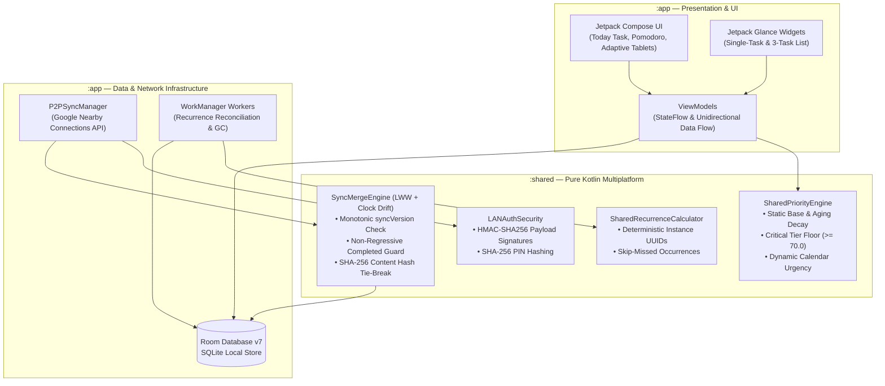
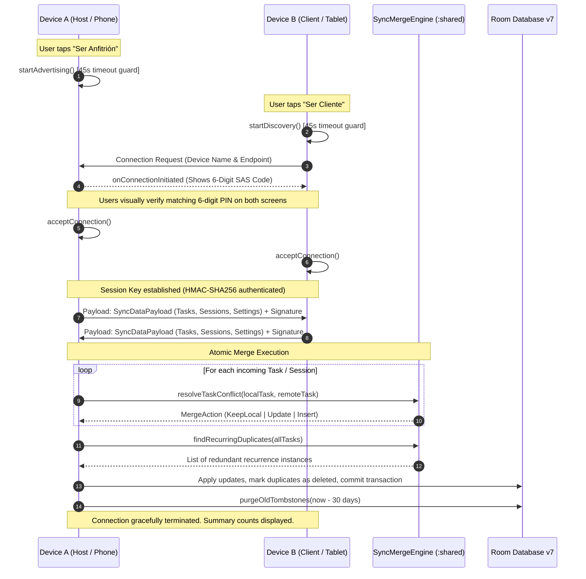
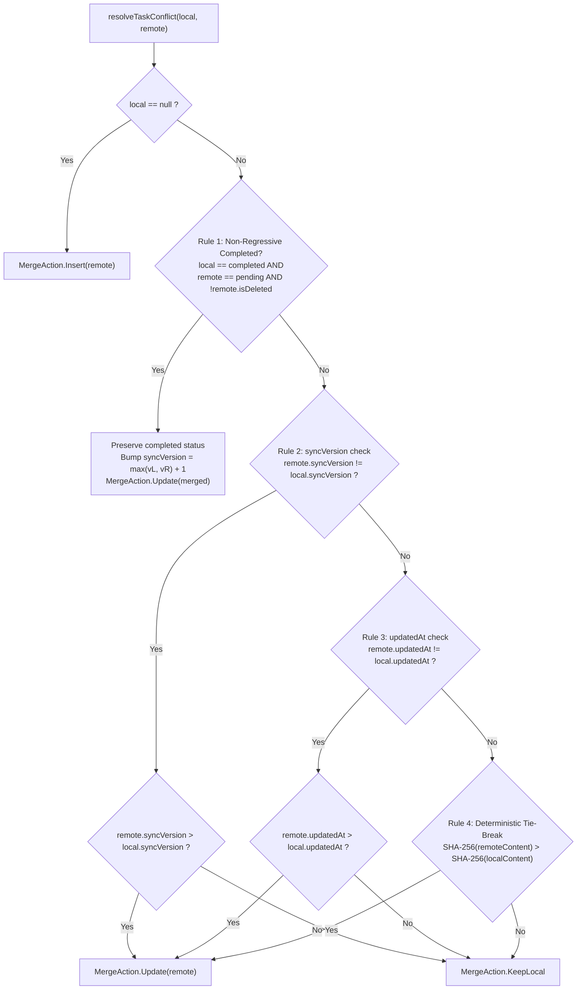
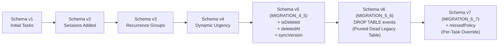

# Prima-Focus System Architecture & Technical Specifications

## 1. Overview
Prima-Focus is a local-first task management and deep work application built with a **modular Kotlin Multiplatform (KMP)** architecture focused on Android (smartphones and tablets). It guarantees complete data ownership, low latency, and zero telemetry by keeping all persistent records on the local device. Peer-to-peer (P2P) synchronization operates entirely over local networks via Google Nearby Connections (Wi-Fi Direct and BLE) with deterministic conflict resolution, eliminating the need for cloud databases, user accounts, or external servers.

---

## 2. Core Stack & Module Boundaries

| Layer / Subsystem | Technology | Purpose |
| :--- | :--- | :--- |
| **Common Domain (`:shared`)** | Kotlin Multiplatform 2.2.10 | Pure business logic, `SharedPriorityEngine`, `SyncMergeEngine`, `SharedRecurrenceCalculator`, models (`Task`, `Session`, `PriorityBand`). Zero Android dependencies. |
| **UI Toolkit (`:app`)** | Jetpack Compose (Material 3) | Declarative UI with Adaptive Window Size layouts (Phone, Tablet Split-View, NavigationRail), Material You dynamic color, custom Canvas particle confetti. |
| **Local Persistence (`:app`)** | Room Database v7 (SQLite) | Relational database with soft-delete tombstones, monotonic `syncVersion`, and safe schema migrations. |
| **Home Screen Widgets (`:app`)** | Jetpack Glance | Interactive single-task and 3-task widgets with optimistic completion and undo notifications. |
| **P2P Networking (`:app`)** | Google Nearby Connections API | Wi-Fi Direct and BLE mesh in `P2P_STAR` topology with 6-digit numeric comparison pairing. |
| **Background Processing (`:app`)** | Android WorkManager & Foreground Services | Recurrence reconciliation, 30-day tombstone garbage collection, and persistent focus session timers. |

---

## 3. High-Level Modular Architecture



---

## 4. Peer-to-Peer (P2P) Synchronization Protocol

Synchronization between devices uses the Google Nearby Connections `P2P_STAR` topology. One device operates as **Host ("Ser Anfitrión")** and the other as **Client ("Ser Cliente")**, authenticated through mutual out-of-band numeric confirmation.

### 4.1. Network Handshake & Mutual Data Exchange Sequence



---

## 5. Distributed Conflict Resolution Engine (`SyncMergeEngine`)

Because devices may work disconnected for days across varying time zones or with drifted system clocks, Prima Focus abandons naive wall-clock Last-Write-Wins in favor of a **version-aware, multi-tier deterministic resolution algorithm**.

### 5.1. Conflict Resolution Flowchart



---

## 6. Distributed State Guarantees

The following 8 invariants are verified by automated unit tests in `SyncConflictMatrixTest.kt` and `P2PSyncTest.kt`:

| Invariant | Problem Solved | Mechanism & Guarantee |
| :--- | :--- | :--- |
| **1. Tombstone Propagation** | Hard deletes on Device A resurrecting on Device B after sync. | Hard deletes are converted to soft-delete tombstones (`isDeleted = true`, `deletedAt`). Higher `syncVersion` ensures the tombstone overwrites older active instances on all peers. |
| **2. Stale Edit Rejection** | Edits made on an out-of-date offline device overwriting newer edits. | Monotonic version checking (`syncVersion`) strictly rejects any incoming payload with an inferior version number (`MergeAction.KeepLocal`). |
| **3. Clock-Drift Immunity** | Devices with un-synchronized or manipulated system clocks overwriting valid edits. | `syncVersion` is strictly checked before `updatedAt`. A device whose clock is hours in the past but has incremented its version will cleanly beat a device with a future-skewed clock. |
| **4. Full-Tie Convergence** | Two devices edit the same task during the exact same millisecond at the same version. | The SHA-256 content hash of all user-visible fields breaks the tie. Both devices compute the hash locally and deterministically converge to the exact same winner without additional network roundtrips. |
| **5. Non-Regressive Completion** | Completed tasks reopening as "pending" because another device synced an older state. | If local state is `completed` and remote is `pending`, the completed state is strictly preserved, and `syncVersion` is bumped to `max(vL, vR) + 1` to heal the divergence permanently. |
| **6. Concurrent Recurrence Dedup** | Two offline devices independently generating the next recurrence for the same day. | Deterministic instance IDs (`UUID.nameUUIDFromBytes("$groupId|$date")`) + `findRecurringDuplicates` identifies and tombstones redundant instances, keeping only the highest-version copy. |
| **7. Settings Convergence** | Synchronized preferences (category emojis, skip-missed policy) diverging across peers. | Last-Write-Wins on `settingsUpdatedAt`, with a stable per-device ID tie-breaker (`remoteDeviceId > localDeviceId`) in case of timestamp equality. |
| **8. Cryptographic Tamper Rejection** | MITM packet manipulation or corrupted transmissions on local Wi-Fi. | Payloads are signed with HMAC-SHA256 using the session secret key derived during the 6-digit SAS pairing handshake; tampered packets fail validation and are dropped immediately. |

---

## 7. Room Database v7 Relational Schema & Migration Lifecycle

Prima Focus maintains an SQLite database with safe linear migrations:



### Automatic 30-Day Tombstone Garbage Collection
To prevent soft-deleted tombstones from bloating SQLite storage indefinitely, an automated garbage collection routine runs on application startup:

```sql
DELETE FROM tasks WHERE isDeleted = 1 AND deletedAt < :cutoffTimestamp;
DELETE FROM sessions WHERE isDeleted = 1 AND deletedAt < :cutoffTimestamp;
```
*(Where `:cutoffTimestamp = System.currentTimeMillis() - 30.days`)*.
