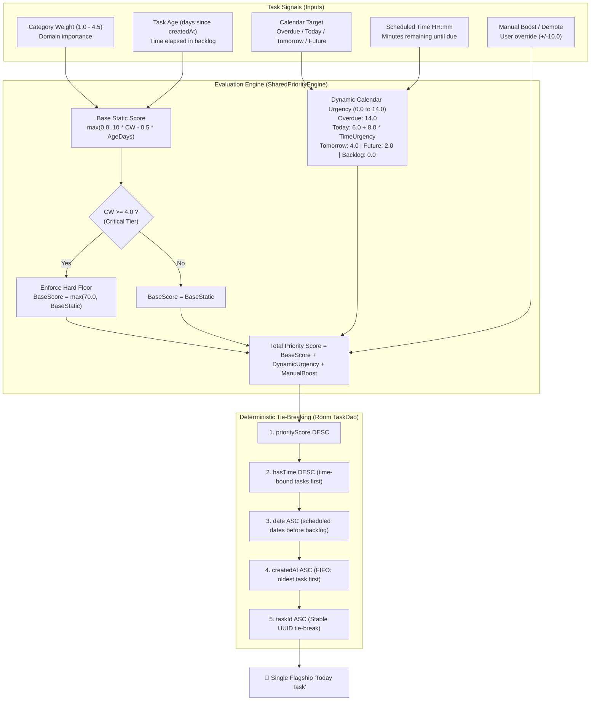

# Predictive Priority Logic & Scoring Engine

The core value proposition of **Prima Focus** is its deterministic, mathematically reproducible task prioritization formula. Unlike opaque machine-learning algorithms or arbitrary manual ordering, Prima Focus evaluates a set of transparent signals to dynamically surface the single most critical **"Today Task"** (and order the backlog) without cloud dependencies or telemetry.

---

## 1. Architectural Pipeline

The prioritization engine operates as a unidirectional evaluation pipeline in the pure Kotlin Multiplatform module (`:shared` via `SharedPriorityEngine`), decoupled from the Android framework:



---

## 2. Mathematical Specification

The total priority score is calculated as:

$$\text{PriorityScore} = \text{BaseScore} + \text{DynamicUrgency} + \text{ManualBoost}$$

### 2.1. Base Score (Static Domain Importance & Aging Decay)

$$\text{BaseScoreStatic} = \max\left(0.0,\; 10 \cdot \text{categoryWeight} - 0.5 \cdot \text{ageDays}\right)$$

Where:
- $\text{categoryWeight} \in [1.0, 4.5]$: Mapped from predefined categories and subcategories (e.g., Health = 4.0, Work Deliverable = 3.5, Chores = 2.0, Leisure = 1.0).
- $\text{ageDays} = \max\left(0.0,\; \frac{\text{currentTimeMs} - \text{createdAt}}{86{,}400{,}000}\right)$: Elapsed days since task creation. Each day in the backlog gradually decays the static score by $0.5$ points to reflect stale lower-tier tasks.
- **Non-Negative Floor Clamp**: The $\max(0.0, \dots)$ guard ensures that tasks pending for months never produce negative static base scores.

#### Hard Constraint: Critical High-Priority Floor ($\ge 70.0$)
To prevent vital obligations (such as taking medical prescriptions or critical job deliveries) from ever being buried by age decay:

$$\text{BaseScore} = \begin{cases} 
\max(70.0, \text{BaseScoreStatic}) & \text{if } \text{categoryWeight} \ge 4.0 \\ 
\text{BaseScoreStatic} & \text{otherwise} 
\end{cases}$$

This hard constraint ensures that any task in a critical category automatically starts with a base score of at least $70.0$, making it mathematically impossible for standard low-urgency tasks to outrank it.

---

### 2.2. Dynamic Calendar Urgency

The dynamic urgency score adds between $0.0$ and $14.0$ points based on calendar scheduling and approaching deadlines:

| Target Calendar State | Condition | Dynamic Urgency Contribution |
| :--- | :--- | :--- |
| **Overdue** | `scheduledDate < currentDate` | **$14.0$ points** (Maximum emergency boost) |
| **Today ("Hoy")** | `scheduledDate == currentDate` | $6.0 \cdot \text{hasDate} + 8.0 \cdot \text{timeUrgency}$ (Range: **$10.8$ to $14.0$ points**) |
| **Tomorrow ("Mañana")** | `scheduledDate == currentDate + 1` | **$4.0$ points** (Moderate visibility without overshadowing today) |
| **Future Date** | `scheduledDate > currentDate + 1` | **$2.0$ points** (Scheduled upcoming) |
| **Unscheduled Backlog** | `scheduledDate == null` | **$0.0$ points** (Rely solely on base score & age) |

#### Time Urgency Factor ($\text{timeUrgency}$)
For tasks scheduled for Today with an explicit time (`hasTime == true`):

$$\text{timeUrgency} = \begin{cases}
1.0 & \text{if } \text{minutesUntil} \le 120 \text{ or } \text{minutesUntil} < 0 \quad (\le 2 \text{ hours remaining or past due today}) \\
0.6 & \text{if } \text{minutesUntil} > 120 \text{ (due later today)} \\
0.6 & \text{if scheduled for Today without a specific time}
\end{cases}$$

---

### 2.3. Manual User Boost ($\text{manualBoost}$)

Users can manually pin, boost, or deprioritize tasks directly from the UI or widgets:
- Boost: $+10.0$ points per tier.
- Demote: $-10.0$ points per tier.
- Symmetrical behavior verified by automated unit tests.

---

## 3. Database Ordering & Multi-Tier Tie-Breaking

When scores are calculated, Room Database (`TaskDao.kt`) queries execute a deterministic 5-level tie-breaking hierarchy:

```sql
SELECT * FROM tasks 
WHERE status = 'pending' AND isDeleted = 0
ORDER BY 
    priorityScore DESC, 
    hasTime DESC, 
    CASE WHEN date IS NULL THEN 1 ELSE 0 END, 
    date ASC, 
    createdAt ASC, 
    taskId ASC
LIMIT 1;
```

1. **`priorityScore DESC`**: The highest mathematical score wins.
2. **`hasTime DESC`**: If two tasks have equal scores, time-slotted tasks take precedence over time-agnostic tasks.
3. **`date ASC` (Non-null first)**: Earlier calendar dates beat later dates or unscheduled backlog.
4. **`createdAt ASC` (FIFO)**: Older tasks that entered the system earlier take precedence.
5. **`taskId ASC`**: Stable alphanumeric UUID tie-breaker ensuring 100% deterministic results across restarts and devices.

---

## 4. End-to-End Comparative Case Study

Consider a user starting their workday at **09:00 AM** with four tasks in their backlog:

| Parameter | Task A (Doctor Appointment) | Task B (Sprint Code Delivery) | Task C (Tax Filing Preparation) | Task D (Read Tech Article) |
| :--- | :--- | :--- | :--- | :--- |
| **Category** | Salud (`categoryWeight: 4.0`) | Trabajo (`categoryWeight: 3.5`) | Finanzas (`categoryWeight: 3.0`) | Ocio / Lectura (`categoryWeight: 1.5`) |
| **Created** | 10 days ago (`ageDays: 10.0`) | Today (`ageDays: 0.0`) | 4 days ago (`ageDays: 4.0`) | 20 days ago (`ageDays: 20.0`) |
| **Date** | Today ("Hoy") | Today ("Hoy") | Tomorrow ("Mañana") | Unscheduled Backlog (`null`) |
| **Time** | 10:30 AM (in 90 min) | 16:00 PM (in 7 hours) | None | None |
| **Manual Boost** | $0.0$ | $0.0$ | $+10.0$ (User pinned) | $0.0$ |
| **Base Static** | $\max(0, 40 - 5) = 35.0$ | $\max(0, 35 - 0) = 35.0$ | $\max(0, 30 - 2) = 28.0$ | $\max(0, 15 - 10) = 5.0$ |
| **Base Score** | **$70.0$** *(Hard floor $\ge 4.0$)* | **$35.0$** | **$28.0$** | **$5.0$** |
| **Dynamic Urgency**| $6.0 + 8.0(1.0) = \mathbf{14.0}$ | $6.0 + 8.0(0.6) = \mathbf{10.8}$ | **$4.0$** *(Tomorrow)* | **$0.0$** *(Backlog)* |
| **Total Score** | **$84.0$** | **$45.8$** | **$42.0$** | **$5.0$** |
| **Final Selection**| 🥇 **Today Task** | 🥈 Backlog #1 | 🥉 Backlog #2 | 4️⃣ Backlog #3 |

### Analysis of the Decision:
- **Task A wins decisively ($84.0$)**: The hard floor of $70.0$ protects the critical health category from its 10-day age decay, and the upcoming 90-minute deadline triggers maximum time urgency ($14.0$).
- **Task B beats Task C ($45.8$ vs $42.0$)**: Even though Task C has a $+10.0$ manual boost, Task B's scheduling for today grants it $10.8$ dynamic urgency over Task C's $4.0$ tomorrow weight.
- **Task D sits at the bottom ($5.0$)**: With no scheduled date and significant age decay, it remains unobtrusively in the backlog until scheduled.

---

## 5. Architectural Trade-offs & Known Limitations

1. **Deterministic Heuristic vs Black-Box ML**: Prima Focus intentionally uses an explicit, audit-friendly mathematical formula instead of neural networks or cloud LLMs. This guarantees zero latency, complete offline execution, zero telemetry, and predictable behavior.
2. **Clock Dependency**: Dynamic urgency depends on the local device clock. To prevent issues during distributed synchronization, priority scores and time urgencies are treated as **device-local derived state** and are never transmitted over the network (each device recalculates them locally against its own clock).
3. **Calendar Density**: The engine does not evaluate free calendar slots or duration bin-packing (e.g., fitting 45-minute tasks into a 50-minute gap). It focuses on *what matters most right now*.
